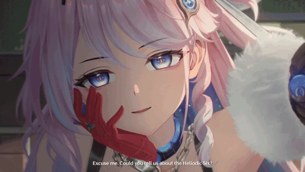

  

  

  

    
    
  

---

### 👨‍💻 About Me

- 🔭 Saya adalah mahasiswa **Semester 1 - Teknik Informatika**
- 🌱 Sedang fokus belajar: `C++` , `Git & GitHub` , `Dasar Pemrograman`
- 🎯 NIM: **552012610006**
- ⚡ Motto: **Menjadi 1% jauh lebih baik ketimbang kemarin**
- 🚀 Project UTS: Sedang membangun fondasi jadi Software Engineer

### 🛠️ Tech Stack - On Progress

  
   
  
  
  
  

---

### 🎮 Pac-Man Contribution - My Code Eaten!

  
   
  <i>Kontribusi harian saya dimakan Pac-Man! 🟡</i>

---

### 📊 GitHub Stats & Streak

  
  
   
  

---

### 🚀 My Projects

#### 📂 Project UTS Semester 1
> Project pertama untuk memenuhi tugas UTS Pertemuan 5. Fokus belajar GitHub flow, dokumentasi README, dan dasar C++.

**🔗 [Lihat Project UTS](https://github.com/IrfanFauzan67/Project-UTS-Semester-1)**
- `main.cpp` - Program C++ pertama
- `README.md` - Dokumentasi lengkap + banner custom
- Dibuat dengan C++ & GitHub

---

  

  ### Terima kasih sudah mampir! 🙌
  *Langkah kecil hari ini, awal perjalanan besar di dunia teknologi!*

  

  
